# FieldQuest 🌿

> **Your neighbourhood is more interesting than your feed.**

FieldQuest is a polished, open-source, AI-powered, offline-first nature exploration Progressive Web App (PWA). It inspires people to spend less time glued to screens and more time exploring the living biodiversity right outside their door—in city parks, balcony pots, quiet suburban streets, or forest trails.

---

## Our Philosophy & Science

FieldQuest is not another superficial chatbot wrapper; it is an **anti-chatbot nature observation tool** engineered with explicit scientific and educational rationale:

1. **Cognitive Science & Attention Restoration Theory (ART):** Rooted in Kaplan & Kaplan's cognitive psychology, prolonged screen interaction depletes direct executive attention. Involuntary natural sensory immersion ("soft fascination") restores focus. FieldQuest actively uses a **Screen-Down Mode** so explorers keep phones in pockets rather than staring at glass while walking.
2. **Botanical Functional Morphology & Bioindicators:** Observational quests train participants in fundamental ecological principles: leaf venation architecture, bark moisture gradients, and lichen as symbiotic bioindicators of urban air quality.
3. **Acoustic Ecology & Soundscape Stratification:** Distinguishing between geophony (wind, water), biophony (birds, insects), and anthrophony (human sounds) to foster auditory mindfulness.
4. **Open-Weight AI Sovereignty:** Prompts are processed locally via Ollama with open-weight models (`qwen2.5:3b` / `qwen3:4b` or Google Gemma) or an instant deterministic fallback engine. Zero telemetry, zero accounts, and zero remote cloud surveillance.
5. **Offline-First Resilience:** In nature trails with zero cellular connectivity, FieldQuest functions completely offline via PWA Service Workers and persists all personal field notes, observations, and photos in IndexedDB (Dexie).

---

---

## 📸 Visual Tour & System Walkthrough

Explore FieldQuest through real interface captures showcasing its core features, Victorian botanical aesthetics, multi-tier AI failover, and containerized architecture.

---

### 1. The Screen-Down Ethos & Sensory Adventure Planner

FieldQuest actively counters "notification fatigue" and "doomscrolling" by encouraging mindful observation rather than screen fixation.

| **The Victorian Study Desk & Philosophy** | **Tailored Adventure Generator** |
|:---:|:---:|
| 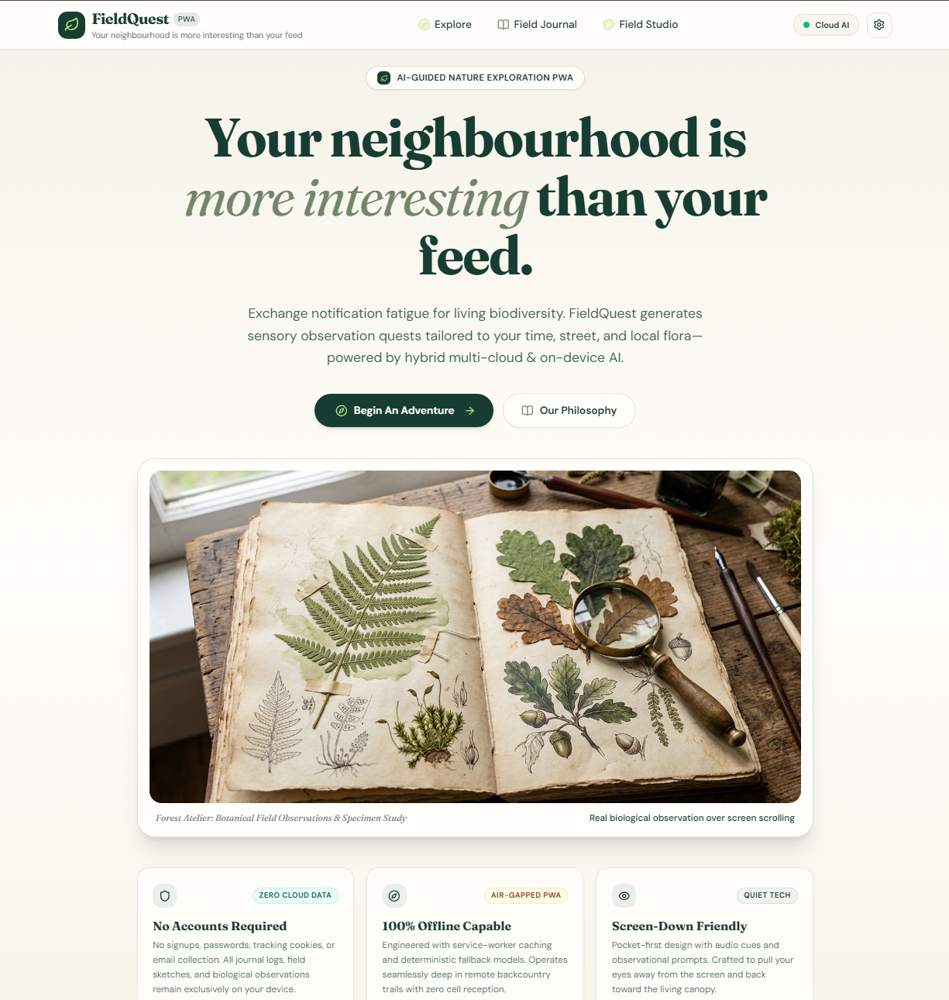 | 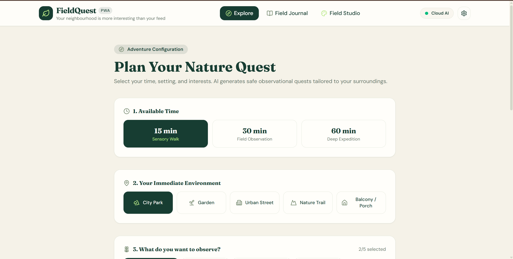 |
| *Hero & Ethos: Zero accounts required, 100% offline capable, and screen-down design.* | *Configure your quest: Select duration (15/30/60m), environment, and sensory focus.* |

- **Problem Solved:** Typical outdoor apps demand constant screen gazing (GPS maps, camera AR). FieldQuest generates tactile sensory missions and then dims the screen so explorers look at living nature with their own eyes.
- **Key Capability:** Generates structured sensory missions (15m sensory walk, 30m field observation, 60m deep expedition) adapted to urban parks, backyards, balcony pots, or forest trails.

---

### 2. Botanical Field Illustrator Studio & Classical Herbarium Folios

An interactive scientific art workshop bringing 19th-century botanical lithography to modern web explorers.

| **Field Illustrator Studio & Reference Folio Plates** | **Archived Specimen Studies & Folio Library** |
|:---:|:---:|
| 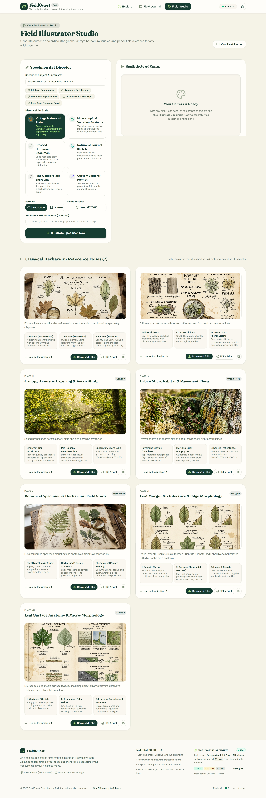 | 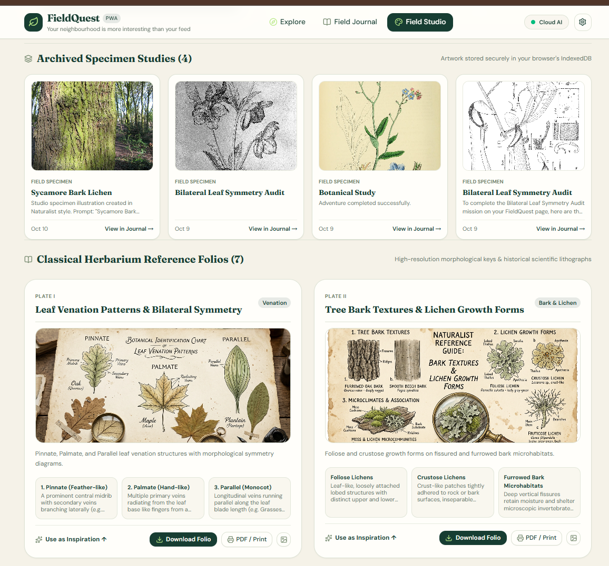 |
| *Specimen Art Director with 6 historical styles and Plates I–VII botanical references.* | *Locally archived specimen studies rendered alongside historical plates.* |

- **Problem Solved:** Most apps provide only generic checklists. FieldQuest provides an artistic synthesis tool for recording diagnostic botanical traits (leaf venation, bark fissures, lichen thalli).
- **Key Capability:**
  - **Specimen Art Director:** Choose historical styles (*Vintage Naturalist Lithograph*, *Microscopic & Venation Anatomy*, *Pressed Herbarium Specimen*, *Fine Copperplate Engraving*).
  - **Classical Plates I–VII:** High-resolution morphological guides (Leaf Venation, Bark & Lichen, Canopy Acoustic Layering, Urban Flora, Herbarium Study, Leaf Margins, Micro-Morphology).
  - **Hardware-Accelerated 2.8× Victorian Loupe:** Inspect microscopic cellular venation and lithograph hatching directly on artboards.
  - **Archival Folio Composite Exporter:** Generates 1200×1580 museum-grade composite PNGs with ornamental Linnaean borders and diagnostic keys.
  - **Single-Card Dedicated PDF & Print:** 1-click museum card printing without browser chrome.

---

### 3. Sensory Field Journal, Soundscape Stratification & Bioindicators

A distraction-free, local-first scientific journal persisted directly in the explorer's browser.

| **Exploration History & Metrics Dashboard** | **Acoustic Stratification & Mission Breakdown** |
|:---:|:---:|
| 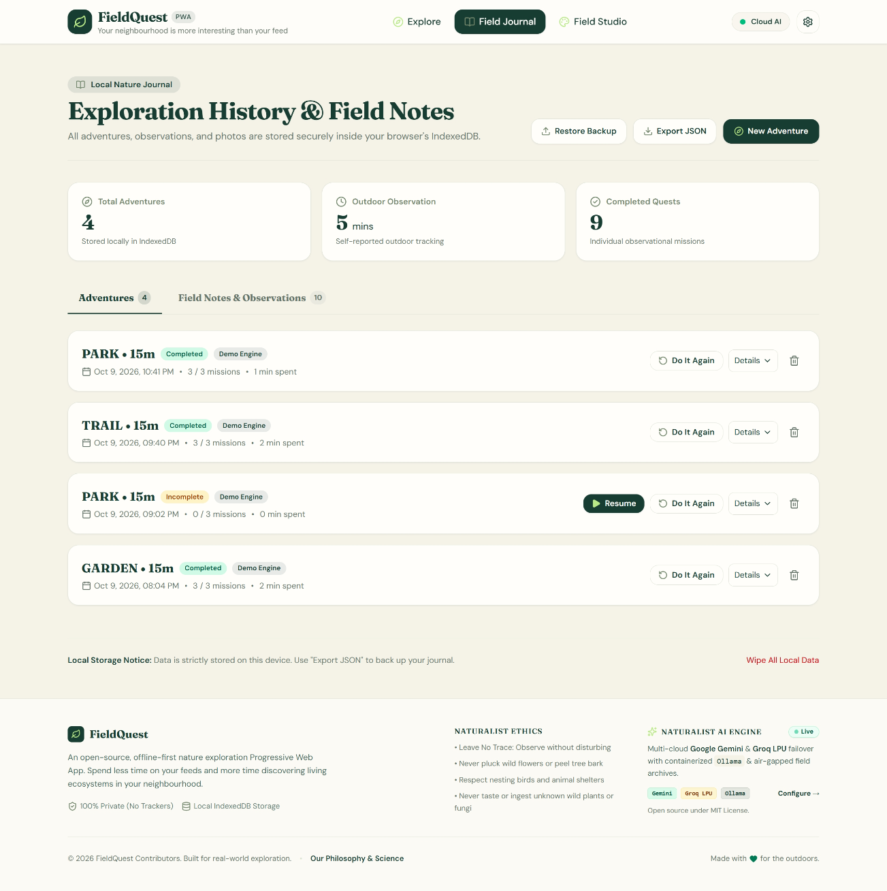 | 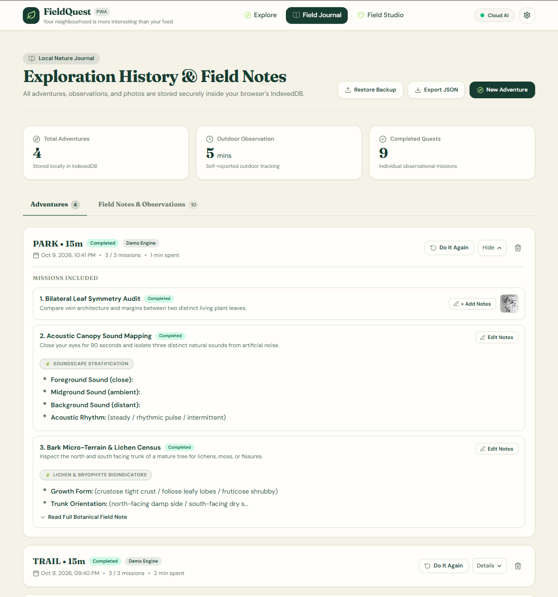 |
| *Personal metrics: Total adventures, outdoor minutes, completed quests (IndexedDB).* | *Acoustic soundscape mapping (Foreground, Midground, Background) and lichen census.* |

| **Field Notes & Specimen Linking** |
|:---:|
| 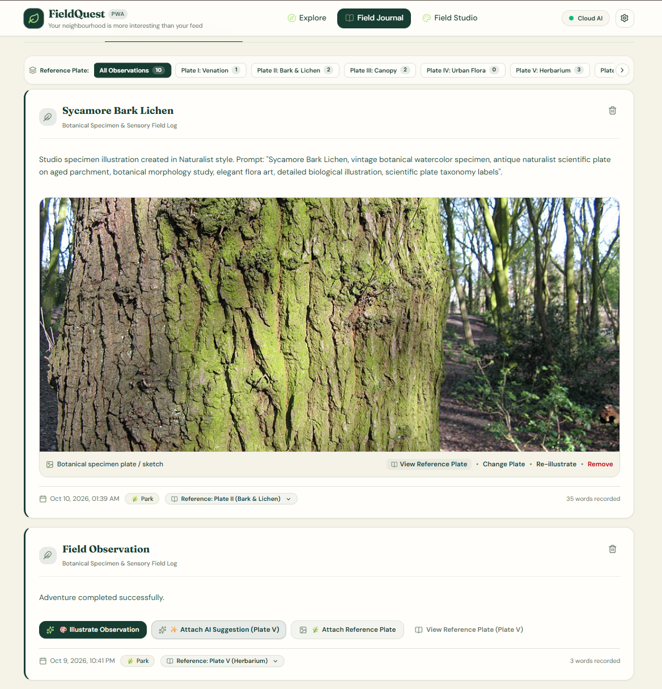 |
| *Observation cards linked to Plates I–VII, location tags, word count, and full backup/restore.* |

- **Problem Solved:** Cluttered social feeds commodify nature into likes and followers. FieldQuest offers an introspective, private scientific notebook.
- **Key Capability:**
  - **Acoustic Soundscape Stratification:** Teaches participants to isolate foreground sounds, ambient midground reverberations, and distant background geophony.
  - **Bioindicator Census:** Guides observation of crustose, foliose, and fruticose lichens to assess urban microclimate and air purity.
  - **100% Data Sovereignty:** All field notes, observations, and photos stay in the browser's IndexedDB. Includes one-click JSON backup and restore.

---

### 4. Dual-Engine AI Architecture: Multi-Cloud Resilience vs. Air-Gapped Local Inference

FieldQuest bridges free-tier multi-cloud AI with sovereign on-device open-weight LLMs in a single interface.

| **Production Multi-Cloud Resilience Matrix** | **Air-Gapped Local AI Container Engine** |
|:---:|:---:|
| 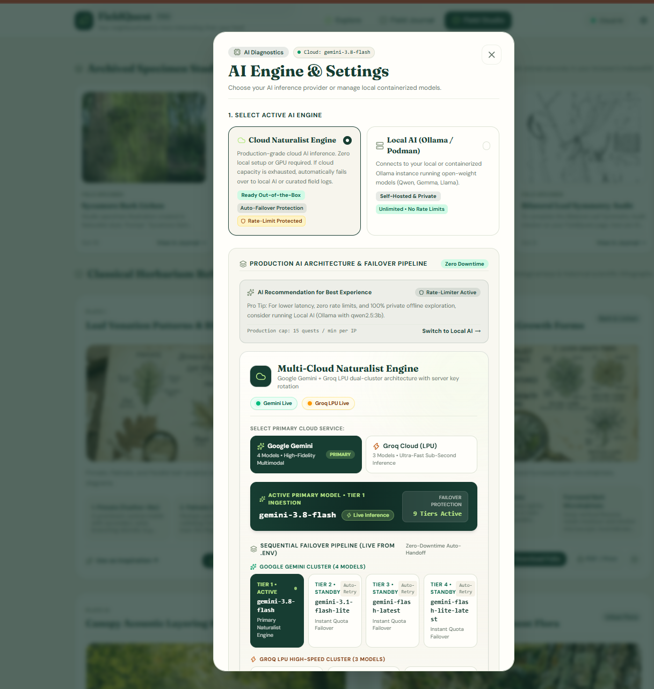 | 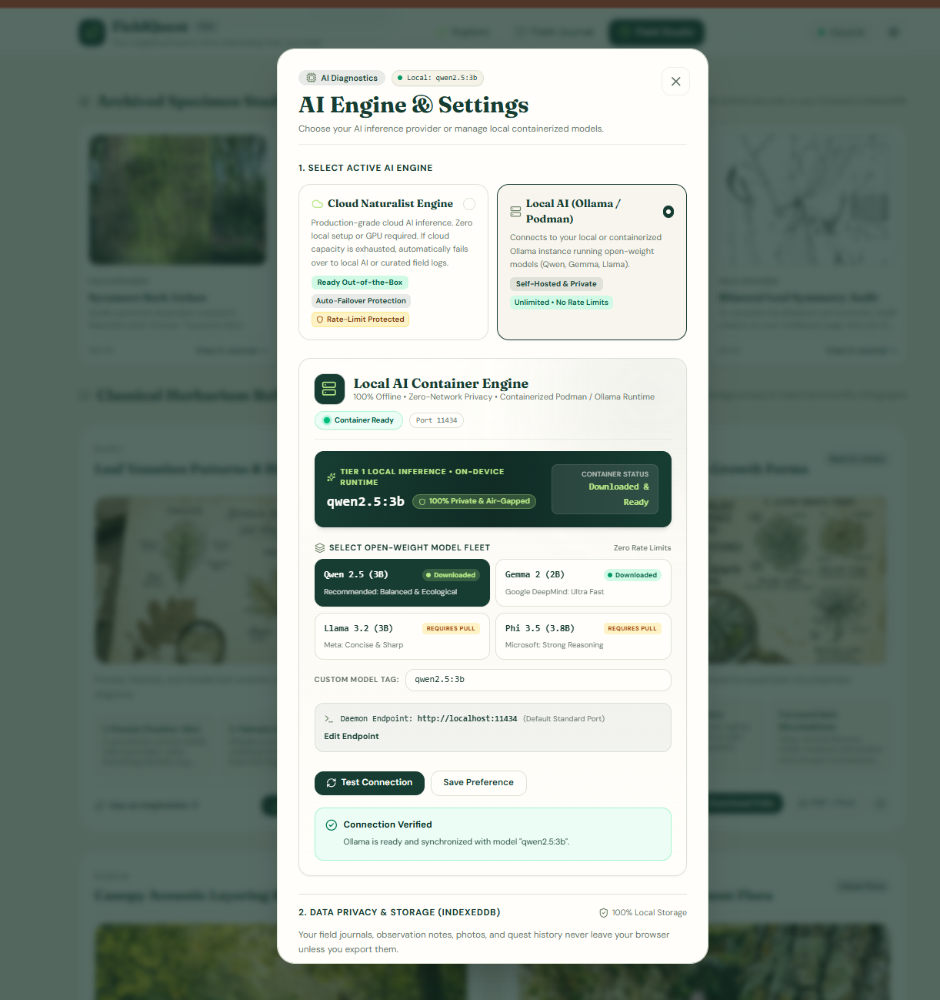 |
| *Production 9-tier cascading failover across Google Gemini & Groq Cloud LPU.* | *100% private, zero-network containerized Ollama (`qwen2.5:3b`, `gemma2:2b`).* |

- **Problem Solved:** Cloud AI APIs suffer from quota limits (HTTP 429), rate limiting, and outages. Local-only AI requires technical setup. FieldQuest seamlessly integrates both.
- **Key Capability:**
  - **Production Multi-Cloud Cluster:** Google Gemini (`gemini-3.8-flash`, `gemini-3.1-flash`, `gemini-flash-latest`) + Groq Cloud LPU (`llama-3.3-70b-versatile`, `llama-3.1-8b-instant`). Auto-switches on quota exhaustion with zero downtime.
  - **On-Device Local AI:** Live containerized Ollama integration running open-weight models (`qwen2.5:3b`, `gemma2:2b`, `llama3.2:3b`, `phi3.5:3.8b`) with live health diagnostics.
  - **Botanical Field Catalog:** Zero-dependency deterministic offline library when both cloud and local LLMs are unreachable.

---

### 5. Production Podman Container Stack & Enterprise Dev Experience

Run FieldQuest as a complete, rootless containerized microservice stack in Podman Desktop or Docker.

| **Podman Desktop Container Pod** | **Lightweight Hardened OCI Images** |
|:---:|:---:|
| 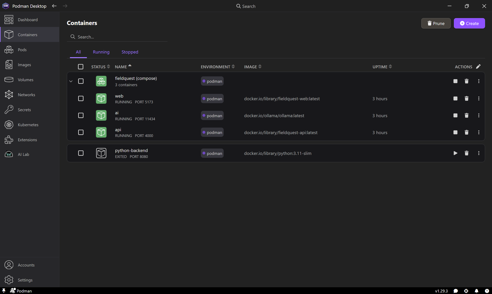 | 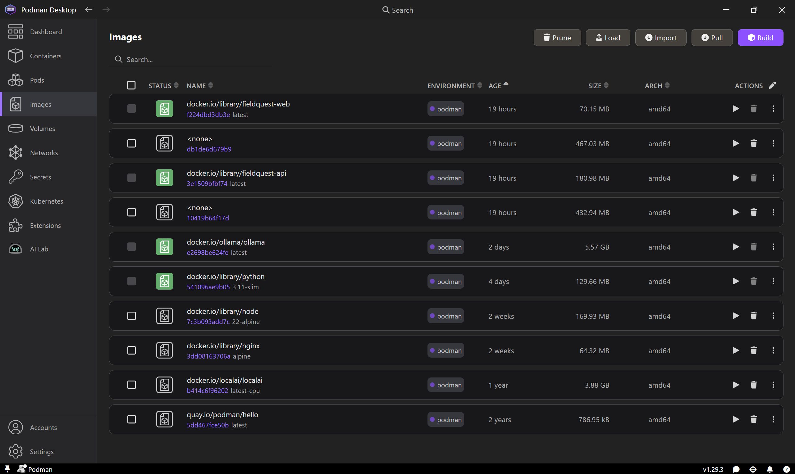 |
| *Compose stack: `web` (5173), `api` (4000), and `ai` (11434) running rootless in Podman.* | *Production alpine images: Web (70 MB), API (180 MB), Ollama (5.5 GB).* |

| **Persistent Model Storage Volume** |
|:---:|
| 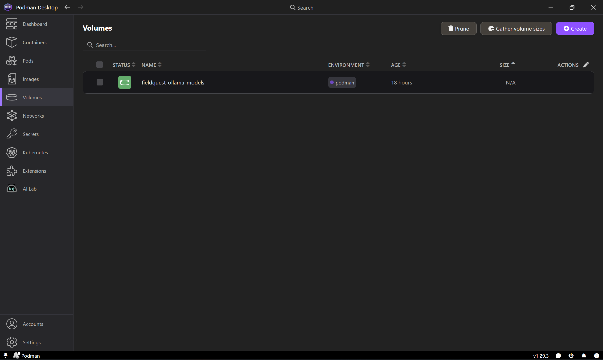 |
| *`fieldquest_ollama_models` persistent volume preserving weights across restarts.* |

- **Problem Solved:** Eliminates "it works on my machine" syndrome and commercial Docker Desktop licensing restrictions.
- **Key Capability:**
  - **Rootless & Daemonless:** Runs securely with Podman without root privileges or heavy background daemons.
  - **Pre-Wired Compose Stack:** Single command (`npm run podman:up`) spins up React PWA, Express API, and Ollama AI engine with pre-configured networking.
  - **Persistent Volumes:** Downloaded open-weight models (`qwen2.5:3b`, `gemma2:2b`) are preserved across container lifecycle events.

---

## 🎯 Core Use Cases & Who It Helps

| Persona / Use Case | The Problem | How FieldQuest Helps |
|:---|:---|:---|
| **Urban Walkers & Commuters** | Nature blindness; walking with eyes glued to social media feeds. | 15-minute quick sensory missions turning standard city sidewalks and urban parks into living biodiversity discovery grounds. |
| **STEM Students & Educators** | Abstract biology lessons without hands-on field experience. | Interactive morphological guides (Plates I–VII) teaching leaf venation architecture, tree bark textures, and lichen bioindicators. |
| **Mindfulness & Mental Health Seekers** | Cognitive fatigue and chronic digital distraction. | Rooted in Kaplan's Attention Restoration Theory (ART); screen-down audio-first prompts restore involuntary attention. |
| **Botanical Illustrators & Journalers** | Lacking easy tools to format and document field findings. | Specimen Art Director with 6 historical styles, 2.8× Victorian loupe, composite 1200×1580 PNG exporter, and 1-page PDF print cards. |
| **Privacy Advocates & Hikers** | Cellular dead zones; distrust of apps demanding logins and tracking location. | 100% offline-first PWA, IndexedDB client storage, zero user accounts, and zero cloud telemetry. |
| **AI Engineers & Open-Source Evaluators** | Frustration with fragile single-provider LLM integrations. | Multi-tier resilience architecture demonstrating automated cross-cloud failover (Gemini + Groq) and air-gapped local LLMs (`qwen2.5`, `gemma2`). |

---

## ⚖️ Comparative Analysis

### 1. FieldQuest vs. Conventional Nature Apps & Social Platforms

| Feature / Dimension | Conventional Social Feeds (Instagram, TikTok) | Commercial Nature ID Apps (Seek, iNaturalist) | **FieldQuest (Our Approach)** |
|:---|:---:|:---:|:---:|
| **Primary Interaction Mode** | Screen-first (infinite vertical scroll) | Camera-first (snap picture, look at screen) | **Screen-Down Mode** (pocket phone, engage sensory listening & touch) |
| **User Privacy & Data Ownership** | Heavy tracking, ad targeting, required login | Cloud sync, public geolocations, required accounts | **100% Private IndexedDB**, zero accounts, zero tracking, local JSON backup |
| **AI Model Autonomy** | Closed algorithmic feeds | Proprietary cloud vision models only | **Hybrid Multi-Cloud + Local Open-Weight** (Gemini, Groq, Ollama `qwen2.5:3b`, `gemma2:2b`) |
| **System Uptime & Failover** | Outage brings whole app down | Single cloud API dependency | **9-Tier Cascading Failover** with zero-dependency deterministic catalog fallback |
| **Artistic & Archival Output** | Ephemeral social story / post | Generic photo gallery / badge | **Archival Folio Lithographs** with 2.8× loupe, 1200×1580 PNG, and 1-page PDF cards |
| **Remote Off-Grid Operation** | Unusable without cell coverage | Limited or degraded without connectivity | **Full PWA Offline Support**; works deep in backcountry trails with zero reception |

---

### 2. Localhost Containerized Setup vs. Public Cloud Deployment

| Feature | **Localhost Development / Podman Setup** | **Public Live Website (`fieldquest.netlify.app`)** |
|:---|:---|:---|
| **Best For** | Full developer control, hackathon evaluation, and air-gapped privacy. | Instant evaluation with zero installation on desktop or mobile. |
| **AI Runtime** | **Local Ollama container** (`qwen2.5:3b`, `gemma2:2b`) or Multi-Cloud. | **Multi-Cloud Naturalist Engine** (Google Gemini & Groq LPU free tiers). |
| **Privacy Level** | 100% air-gapped; prompts never leave your local machine. | Zero user accounts, zero cookies, journal stored in browser IndexedDB. |
| **Hardware Required** | Moderate CPU/RAM (Ollama runs comfortably on 8GB+ RAM). | Zero installation; runs smoothly on any modern browser or mobile phone. |
| **How to Access** | Run `npm run dev` or `npm run podman:up` at `http://localhost:5173`. | Visit public URL directly from phone or browser. |

---

## 🏆 Evaluator & Judge 3-Minute Quickstart

If you are evaluating this project for an event, hackathon, or code review:

1. **Experience the Ethos:** Land on the home page (`/`) to review the Victorian study desk, philosophy principles, and sensory nature mission rationale.
2. **Launch a Quest in 30 Seconds:** Click **"Begin An Adventure"** (`/setup`), pick **"15 min Sensory Walk"**, choose **"City Park"**, and generate an active quest. Observe the **Screen-Down Mode** toggle.
3. **Inspect the Botanical Studio:** Navigate to **Field Studio** (`/studio`). Select an art style, click **"Download Folio"** to generate a 1200×1580 composite PNG with Linnaean border, or click **"PDF / Print"** for clean single-card museum printing.
4. **Test the 9-Tier AI Resilience:** Click the **AI Engine & Settings** icon (gear in header). Observe the live cloud failover cluster (Gemini 2.5/2.0/1.5 & Groq LPU). If evaluating locally, switch to **"Local AI"** to test live containerized Ollama inference.
5. **Review Offline Persistence:** Open **Field Journal** (`/journal`). Notice all adventures and notes are safely stored in **IndexedDB**. Test the **"Export JSON"** backup feature.

---

## ⚡ Key Technical & User Features

- 🍃 **Context-Aware Nature Missions:** Generates tailored 15, 30, or 60-minute observational quests based on your environment, interests, difficulty, and time.
- ☁️ **Cloud Naturalist Engine (Production AI):** Powered by free-tier production cloud models (Google Gemini 2.5/2.0/1.5 Flash & Groq Cloud Llama 3.3 70B). Zero GPU or local installation required, zero client credentials needed.
- 🔄 **9-Tier Resilience Matrix:** Seamless cascading failover across Google Gemini cluster (`gemini-2.5-flash` down to `gemini-1.5-flash-8b`), Groq LPU cluster (`llama-3.3-70b-versatile` & `llama-3.1-8b-instant`), local Ollama container, and our zero-dependency Curated Field Library, guaranteeing 100% uptime.
- 🎨 **Creative Field Studio (`/studio`):** An interactive botanical illustration workshop to sketch wild specimens, experiment with historical scientific art styles (*Vintage Naturalist Lithograph*, *Microscopic Anatomy*, *Pressed Herbarium Specimen*, *Field Graphite Pencil*), randomize seeds, and download high-resolution diagnostic plates.
- 🔍 **Interactive Victorian Naturalist Loupe:** A hardware-accelerated 2.8× optical magnifying glass for inspecting fine leaf venation, spore structures, and pen-and-ink lithographic hatching directly on specimen artboards.
- 📜 **Archival Folio Composite Exporter:** High-resolution 1200 × 1580 composite PNG generator (HTML5 Canvas 2D, zero dependencies) rendering botanical plates framed with ornamental borders, titles, descriptions, and 3 diagnostic key cards.
- 🖨️ **Single-Card Dedicated PDF & Print:** Isolated 1-page museum-grade print engine (`printSingleSpecimenFolio`) allowing explorers to print physical field cards or save vector-sharp PDFs without website chrome.
- 🌿 **Classical Herbarium Reference Folios:** 7 curated anatomical reference plates (Plates I–VII: Venation, Bark & Lichen, Canopy, Urban Flora, Herbarium, Margins, Surface) with diagnostic keys, matching between Field Studio and the Field Journal.
- 📖 **Focused Local Nature Journal (`/journal`):** A distraction-free explorer's log with dedicated **Adventures** history and **Field Notes & Observations** logs. Includes full JSON export and restore backup functionality.
- 🧠 **Local Open-Weight AI (Ollama / Podman):** Optional self-hosted inference via local Ollama instances running open-weight models (`qwen2.5:3b` / Gemma), keeping prompts and insights private and sovereign.
- ⚡ **Curated Offline Engine:** High-fidelity deterministic mission generator for immediate exploration without needing any AI server or connectivity.
- 📴 **True Offline-First Architecture:** Uses IndexedDB (Dexie) for durable local storage of all adventures, field notes, and reflections. The PWA shell caches assets for seamless offline operation.
- 📵 **Screen-Down Mode:** Put your phone in your pocket and explore with your senses; screen dims to save battery and reduce distraction.
- 🏛️ **Our Philosophy & Science Modal:** Comprehensive interactive educational chapters explaining the cognitive science, morphology, acoustic ecology, and privacy design behind FieldQuest.
- 🔒 **Absolute Privacy:** No mandatory accounts, no cloud sync of personal field journals, no tracking, and no invasive background GPS logging.

---

## Core User Interface Layout

```
+---------------------------------------------------------------------------------+
|  [🌿 FieldQuest PWA]       [Explore]  [Active Quest]  [Field Journal]  [Field Studio]  |
+---------------------------------------------------------------------------------+
|                                                                                 |
|  [EXPLORE / SETUP]        [FIELD JOURNAL]                 [FIELD STUDIO]        |
|  - 15/30/60m durations    - Adventures History            - Art Style Presets   |
|  - Habitat selection      - Field Notes & Observations    - Victorian Loupe (2.8x)
|  - Mobility accessible    - 7 Reference Plates (I-VII)    - Composite Folio PNG |
|  - 9-Tier AI Engine       - JSON Backup & Restore         - 1-Page Dedicated PDF|
|                                                                                 |
+---------------------------------------------------------------------------------+
```

---

## Architecture Overview

```
Browser PWA (React 19 + Tailwind v4 + Dexie IndexedDB + HTML5 Canvas)
   │
   ├─► Local Nature Journal (IndexedDB: Adventures, Field Notes, Observation Photos)
   ├─► Field Studio (Victorian Loupe, 7 Reference Folios, Folio Exporter)
   │
   ▼ (REST API: /api/v1/*)
Express 5 API Service (Node.js LTS)
   │
   ├─► [Tiers 1-5] Google Gemini Cluster (2.5-Flash → 2.0-Flash → 2.0-Flash-Lite → 1.5-Flash → 1.5-Flash-8b)
   ├─► [Tiers 6-7] Groq LPU Cluster (Llama 3.3 70B Versatile → Llama 3.1 8B Instant)
   ├─► [Tier 8]   Ollama Local Container (qwen2.5:3b / gemma2:2b on port 11434)
   └─► [Tier 9]   Deterministic Curated Naturalist Library (100% offline air-gapped fallback)
```

See [docs/ARCHITECTURE.md](docs/ARCHITECTURE.md) and [docs/TRD.md](docs/TRD.md) for full system diagrams and data flow specifications.

---

## Technology Stack

- **Frontend:** React 19, TypeScript, Vite, Tailwind CSS v4, React Router, TanStack Query, Zustand, Dexie.js (IndexedDB), `vite-plugin-pwa`, Framer Motion, Lucide React, Zod.
- **Backend:** Node.js (LTS), Express 5, TypeScript, Zod, CORS, Express Rate Limit.
- **AI Inference:** Multi-tier inference engine:
  1. **Production Cloud AI:** Google Gemini (1.5 Flash / 2.0 Flash) & Groq Cloud (Llama 3.3 70B / Qwen 2.5) free tier.
  2. **Local AI:** Ollama running open-weight `qwen2.5:3b`, `qwen3:4b`, or Google Gemma 2.
  3. **Curated Offline Engine:** 100% deterministic, naturalist-verified offline catalog.
- **Testing:** Vitest, Supertest, React Testing Library.

---

## Prerequisites

- **Node.js:** Current LTS (>= 20.x, tested with Node 24.x)
- **npm:** >= 10.x
- *(Optional for cloud AI)* **Google AI Studio or Groq API Key:** Free tier keys configured in `.env`.
- *(Optional for local AI)* **Ollama / Podman:** [ollama.com](https://ollama.com) or [podman.io](https://podman.io)

---

## Installation & Local Setup

```bash
# 1. Clone repository
git clone https://github.com/arnab825/FieldQuest.git
cd FieldQuest

# 2. Install workspace dependencies
npm install

# 3. Configure environment file
cp .env.example .env
```

### Environment Variables (`.env`)

```env
# Backend Server Configuration
PORT=4000
NODE_ENV=development
CLIENT_ORIGIN=http://localhost:5173

# AI Inference Engine Configuration ('cloud' | 'ollama' | 'demo')
AI_PROVIDER=cloud
CLOUD_PROVIDER=gemini

# Google Gemini Multi-Model Cluster (Free Tier)
GEMINI_API_KEY=your_gemini_api_key_here
GEMINI_MODEL=gemini-3.8-flash
GEMINI_MODELS=gemini-3.8-flash,gemini-3.1-flash-lite,gemini-flash-latest,gemini-flash-lite-latest

# Groq Cloud Ultra-Fast LPU Cluster (Free Tier)
GROQ_API_KEY=your_groq_api_key_here
GROQ_MODEL=llama-3.3-70b-versatile
GROQ_MODELS=llama-3.3-70b-versatile,llama-3.1-8b-instant,openai/gpt-oss-120b

# Local Ollama AI Engine (Air-Gapped Failover)
OLLAMA_BASE_URL=http://localhost:11434
OLLAMA_MODEL=qwen2.5:3b
OLLAMA_TIMEOUT_MS=45000

# Rate Limiting
RATE_LIMIT_WINDOW_MS=60000
RATE_LIMIT_MAX=60

# Web Frontend Configuration (apps/web)
VITE_API_BASE_URL=http://localhost:4000
```

---

## Running the Application

### Option A: Standard Mode (Cloud Naturalist Engine + Auto-Failover)
FieldQuest runs out of the box with zero setup. If cloud keys are provided in `.env`, it runs via production cloud models. If keys are missing or exhausted, it automatically fails over to local Ollama or the curated naturalist library:

```bash
# Starts both frontend (port 5173) and API (port 4000)
npm run dev
```

- Open your browser to **http://localhost:5173**
- The backend will run on **http://localhost:4000**

You can also run them in separate terminal tabs:
```bash
# Web frontend
npm run dev:web

# Backend API
npm run dev:api
```

---

## Running with Podman (Containerized Setup)

FieldQuest provides first-class support for **[Podman](https://podman.io/)** and **[Podman Desktop](https://podman-desktop.io/)** for both local development and production deployments.

### Why We Choose Podman
- **Rootless & Secure by Default:** Podman containers run without root privileges, protecting your host machine.
- **Daemonless:** Unlike Docker, Podman does not require a heavy background daemon constantly running or consuming background RAM.
- **100% Open Source (Apache 2.0):** Completely free with zero commercial licensing costs or enterprise restrictions.
- **OCI & Compose Compatible:** Drop-in compatibility with standard multi-stage Containerfiles and Compose specifications (`podman-compose.yml` / `docker-compose.yml`).
- **Kubernetes-Ready:** Native support for generating and running Kubernetes Pod manifests and integrating with Podman Desktop's built-in Kind cluster.

### Setup & Prerequisites Links
- 📦 **Download Podman Desktop:** [https://podman-desktop.io/](https://podman-desktop.io/)
- 📖 **Podman Official Documentation:** [https://podman.io/docs](https://podman.io/docs)
- ⚙️ **Installation Guide (Windows / macOS / Linux):** [https://podman.io/docs/installation](https://podman.io/docs/installation)

### Option 1: Using the Terminal
From your project directory:

```bash
# 1. Build the container images (Web & API)
npm run podman:build

# 2. Start all 3 containers (Web, API, and Ollama AI Engine)
npm run podman:up

# 3. Pull your open-weight AI model inside the container (e.g., qwen2.5:3b)
npm run podman:pull-model

# 4. View live streaming logs
npm run podman:logs

# 5. Stop when done
npm run podman:down
```

### Option 2: Directly in Podman Desktop UI
1. Open **[Podman Desktop](https://podman-desktop.io/)**.
2. Go to the **Containers** or **Pods** view in the sidebar.
3. Once you launch the stack (`npm run podman:up`), all 3 services (`fieldquest-web`, `fieldquest-api`, and `fieldquest-ai`) will be visible in your Podman Desktop dashboard.
4. You can inspect live CPU/RAM resource usage, click into real-time container logs, and pause or stop containers with one click.

### Application Routes & Endpoints
- 🌿 **Home & Ethos:** [http://localhost:5173/](http://localhost:5173/)
- 🧭 **Explore / Setup:** [http://localhost:5173/setup](http://localhost:5173/setup)
- ⚡ **Active Quest Screen:** [http://localhost:5173/adventure](http://localhost:5173/adventure)
- 📖 **Field Journal:** [http://localhost:5173/journal](http://localhost:5173/journal)
- 🎨 **Field Studio:** [http://localhost:5173/studio](http://localhost:5173/studio)
- ⚙️ **API Status:** [http://localhost:4000](http://localhost:4000/)
- 🧠 **Ollama AI Engine:** [http://localhost:11434](http://localhost:11434/)
- 🩺 **API Health Check:** [http://localhost:4000/api/v1/health](http://localhost:4000/api/v1/health)

---

## Production Cloud AI Setup (Gemini & Groq with Multi-Model Fallbacks)

FieldQuest natively supports production cloud models out-of-the-box using Google Gemini and Groq Cloud, complete with **automatic multi-model fallback chains**. If a model hits quota, is rate-limited (429), or is unavailable, FieldQuest automatically falls back to the next model in the list:

```env
# Google Gemini (free-tier cloud models with fallback chain)
GEMINI_API_KEY=your_gemini_api_key_here
GEMINI_MODELS=gemini-3.8-flash,gemini-3.1-flash-lite,gemini-flash-latest,gemini-flash-lite-latest

# Groq Cloud (ultra-fast inference models with fallback chain)
GROQ_API_KEY=your_groq_api_key_here
GROQ_MODELS=llama-3.3-70b-versatile,llama-3.1-8b-instant,openai/gpt-oss-120b
```

---

## Setting Up Real Local AI with Ollama

> [!WARNING]
> **Production Website vs. Localhost AI Limitation:**
> Modern web browsers (Chrome, Edge, Safari) strictly block public HTTPS websites (such as `https://fieldquest.netlify.app`) from sending requests to private local IP addresses (`http://localhost:11434`) under browser **Mixed-Content** & **Private Network Access (PNA)** security rules.
> 
> - **To run 100% Real Local AI (Ollama / Podman `qwen2.5:3b`):** You **must** clone the repository and run FieldQuest locally at **`http://localhost:5173`**.
> - **On the Public Live Website (`fieldquest.netlify.app`):** Use the default **"Production Multi-Cloud"** engine (Google Gemini & Groq LPU) or the **"Botanical Field Catalog"** — both work out-of-the-box for all visitors without any installation.

To use live open-weight model generation locally:

1. **Install and start Ollama:**
   ```bash
   ollama serve
   ```
   *(If connecting directly from the web browser/Netlify, enable CORS: `OLLAMA_ORIGINS="*" ollama serve` or `$env:OLLAMA_ORIGINS="*" ; ollama serve` on Windows).*

2. **Pull your preferred open-weight model:**
   - **Google Gemma 2 (2B)** — *Ultra-fast, lightweight & optimized by Google DeepMind (1.6 GB):*
     ```bash
     ollama pull gemma2:2b
     # Or inside the Podman container:
     npm run podman:pull-gemma
     ```
   - **Alibaba Qwen 2.5 (3B)** — *Default balanced botanical & ecological specialist (1.9 GB):*
     ```bash
     ollama pull qwen2.5:3b
     # Or inside the Podman container:
     npm run podman:pull-model
     ```
   - **Meta Llama 3.2 (3B)** — *Concise & sharp nature observation prompts (2.0 GB):*
     ```bash
     ollama pull llama3.2:3b
     ```
   - **Microsoft Phi 3.5 (3.8B)** — *Strong scientific reasoning (2.2 GB):*
     ```bash
     ollama pull phi3.5:3.8b
     ```

3. **Configure your `.env`:**
   ```env
   AI_PROVIDER=ollama
   OLLAMA_BASE_URL=http://localhost:11434
   OLLAMA_MODEL=gemma2:2b   # or qwen2.5:3b, llama3.2:3b, phi3.5:3.8b
   ```

4. **Restart the API:**
   ```bash
   npm run dev:api
   ```
   Check `http://localhost:4000/api/v1/ai/status` to confirm `"status": "available"`.

---

## Testing & Production Builds

```bash
# Run all tests across workspaces
npm test

# Run TypeScript checks
npm run typecheck

# Build both applications for production
npm run build
```

---

## Offline Limitations & Behavior

1. **Cached Application Shell:** The PWA Service Worker automatically caches core scripts, styles, and assets so the app loads when offline.
2. **Local Persistence:** All adventures, notes, photos, and journal entries are saved directly inside your browser's IndexedDB. They remain accessible offline across restarts.
3. **AI Generation when Offline:** If you are outside cell coverage and not running a local on-device LLM, new AI mission generation is paused; however, previously saved adventures and offline demo quests remain fully playable.

---

## Security & Privacy Guarantees

- **No Remote Tracking:** FieldQuest collects zero telemetry.
- **Local Data Ownership:** Your journal reflections and photos never leave your device.
- **Ecological Safety:** Generated missions strictly prohibit ingesting unknown flora, disturbing wild animal habitats, or trespassing.

---

## Production Deployment (Netlify + Render + GitHub)

FieldQuest is pre-configured for modern free-tier deployment decoupling the static PWA from the backend API:

### 1. Frontend PWA on Netlify
- **Config**: Auto-detected via [`netlify.toml`](netlify.toml) and [`apps/web/public/_redirects`](apps/web/public/_redirects).
- **Build Command**: `npm run build:web`
- **Publish Directory**: `apps/web/dist`
- **Environment Variable**: `VITE_API_BASE_URL=https://fieldquest-api.onrender.com`

### 2. Backend Express 5 API on Render
- **Config**: Auto-configured via [`render.yaml`](render.yaml) Blueprint or as a standard Node Web Service.
- **Build Command**: `npm ci && npm run build:api`
- **Start Command**: `node apps/api/dist/server.js`
- **Health Check Path**: `/api/v1/health`
- **Environment Variables**:
  - `NODE_ENV=production`
  - `PORT=10000`
  - `AI_PROVIDER=cloud`
  - `GEMINI_API_KEY=your_gemini_key`
  - `GROQ_API_KEY=your_groq_key`
  - `CLIENT_ORIGIN=https://your-app.netlify.app`

### 3. Automated CI/CD on GitHub
- Auto-verifies TypeScript typechecks, Vitest test suites, and production builds on push/PR via [`.github/workflows/ci.yml`](.github/workflows/ci.yml).

For comprehensive options including Podman containers and self-hosted VPS setups, see [docs/DEPLOYMENT.md](docs/DEPLOYMENT.md).

---

## Documentation Index

- [Product Requirements Document (PRD)](docs/PRD.md)
- [Technical Requirements Document (TRD)](docs/TRD.md)
- [System Architecture & Diagrams](docs/ARCHITECTURE.md)
- [Forest Atelier Design System](docs/DESIGN_SYSTEM.md)
- [Local Development Guide](docs/DEVELOPMENT.md)
- [Testing & Quality Assurance](docs/TESTING.md)
- [Production Deployment Guide](docs/DEPLOYMENT.md)
- [Contribution Guidelines](CONTRIBUTING.md)

---

## License

This project is licensed under the [MIT License](LICENSE).
