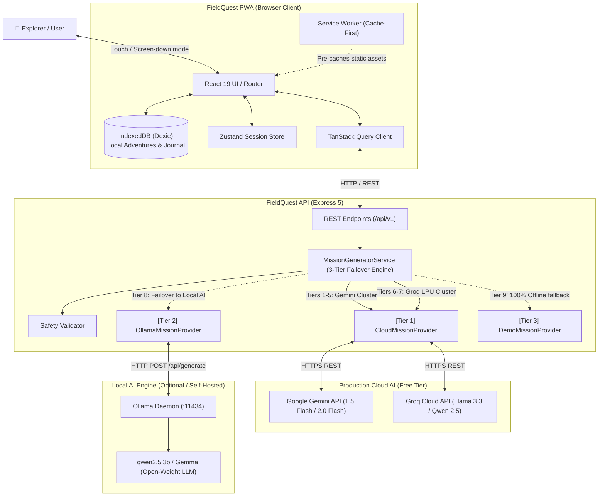
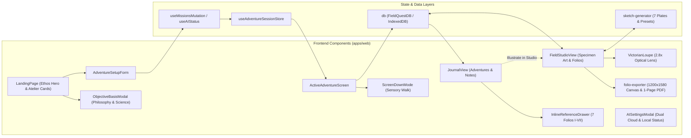
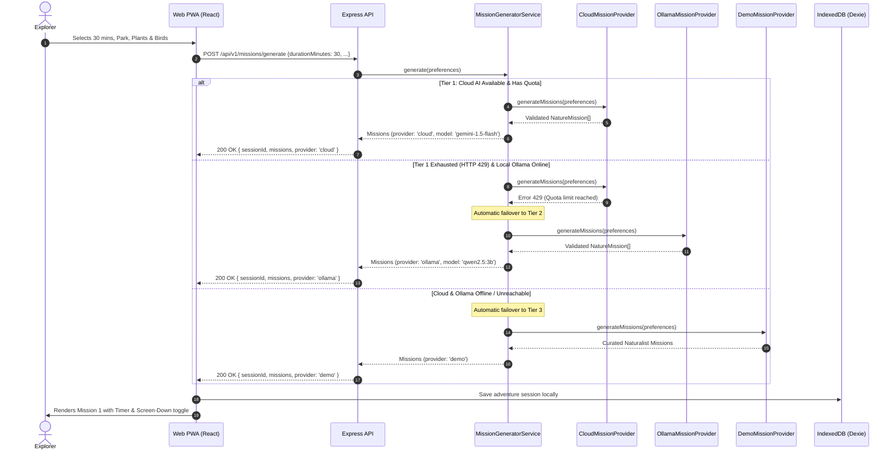
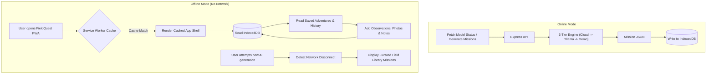

# FieldQuest - Architecture & System Design

## 1. System Context Diagram



---

## 2. Component Architecture Diagram



---

## 3. Mission Generation & Failover Sequence Diagram



---

## 4. Offline Data-Flow Diagram



---

## 5. Deployment Architecture Diagram

```mermaid
graph TD
    subgraph Client_Hosting["Client Hosting (Vercel / Cloudflare Pages / Static CDN)"]
        CDN["Global Edge CDN"]
        PWA_Assets["PWA Bundle (HTML, CSS, JS, Service Worker, Manifest)"]
        CDN --- PWA_Assets
    end

    subgraph User_Device["User Device (Smartphone / Laptop)"]
        Browser["Mobile / Desktop Browser"]
        LocalIDB[("IndexedDB Local Store")]
        Browser --- LocalIDB
    end

    subgraph Backend_Hosting["Production Backend (Render / Railway / Fly.io / VPS / Podman)"]
        NodeAPI["Node.js Express 5 API"]
        EnvConfig["Server .env Secrets (GEMINI_API_KEY, GROQ_API_KEY)"]
        NodeAPI --- EnvConfig
    end

    subgraph Cloud_Providers["External AI Free Tier"]
        GeminiAPI["Google Gemini 1.5/2.0 Flash"]
        GroqAPI["Groq Cloud Llama 3.3"]
    end

    subgraph Optional_Self_Host["Optional Self-Hosted Host"]
        LocalOllama["Ollama Daemon (:11434)"]
    end

    Browser <-->|HTTPS (Get Assets)| CDN
    Browser <-->|HTTPS REST (Zero Client Keys)| NodeAPI
    NodeAPI <-->|HTTPS API Calls| GeminiAPI
    NodeAPI <-->|HTTPS API Calls| GroqAPI
    NodeAPI -.->|Optional Local Host| LocalOllama
```

---

## 6. Key Architectural Decisions & Trade-Offs

| Decision | Rationale | Trade-Off Considered |
|---|---|---|
| **Zero-Client-Key Cloud Architecture** | Keys (`GEMINI_API_KEY`, `GROQ_API_KEY`) stay strictly on the server in `.env`. Regular explorers get instant production AI with zero signup friction. | Host maintains server `.env` keys. |
| **Automatic 3-Tier Failover Pipeline** | Cloud (Tier 1) -> Ollama (Tier 2) -> Curated Library (Tier 3) guarantees missions never fail even when free-tier quotas expire. | Generation may fall back to curated templates without error popups. |
| **Dexie / IndexedDB over Remote DB** | Absolute zero friction, zero signups, true local-first privacy, zero server maintenance costs for personal field notes. | Data is device-bound unless user explicitly exports JSON backup. |
| **Monorepo (apps/web + apps/api)** | Single cohesive repository for shared schemas, synchronized types, and single command startup. | Requires npm workspace configuration. |
| **Ollama Open-Weight Sovereignty** | Local open-weight models (`qwen2.5:3b`, Gemma) preserve full user privacy for developers and offline self-hosters. | Requires running local Ollama daemon or container. |
| **Tailwind CSS v4 with Forest Atelier tokens** | Extremely high aesthetic quality with CSS variables, high rendering performance, zero external CSS runtime overhead. | Custom configuration required for Fraunces and DM Sans typography. |
