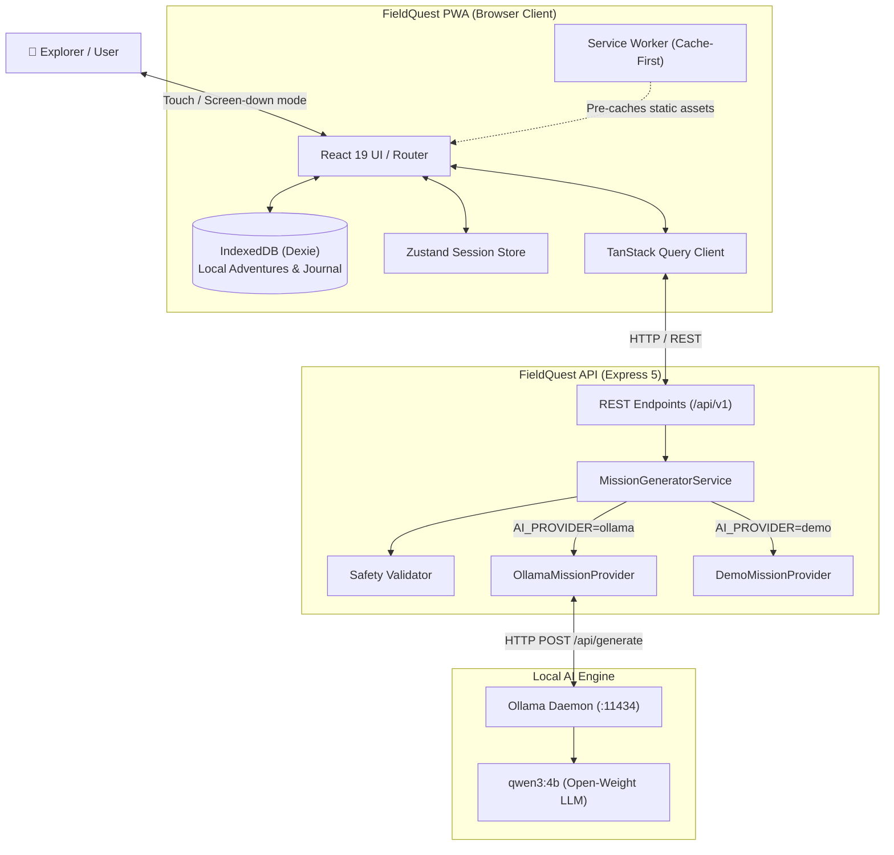
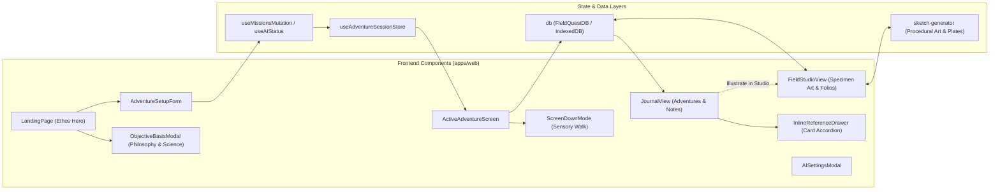
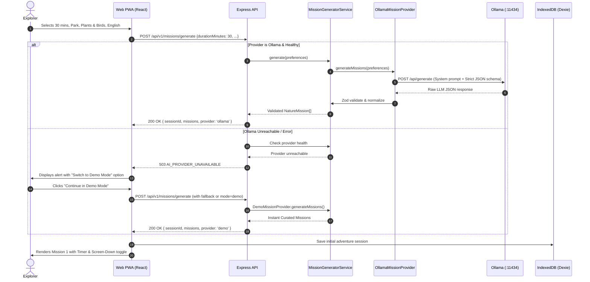
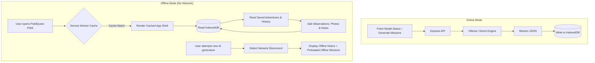

# FieldQuest - Architecture & System Design

## 1. System Context Diagram



---

## 2. Component Architecture Diagram



---

## 3. Mission Generation Sequence Diagram



---

## 4. Offline Data-Flow Diagram



---

## 5. Deployment Architecture Diagram

```mermaid
graph TD
    subgraph Client_Hosting["Option A: Static PWA Hosting (e.g. Vercel, Cloudflare Pages)"]
        CDN["Global Edge CDN"]
        PWA_Assets["PWA Bundle (HTML, CSS, JS, Service Worker, Manifest)"]
        CDN --- PWA_Assets
    end

    subgraph User_Device["User Device (Smartphone / Laptop)"]
        Browser["Mobile / Desktop Browser"]
        LocalIDB[("IndexedDB Local Store")]
        Browser --- LocalIDB
    end

    subgraph Backend_Host["Dedicated Node.js & Inference Host (e.g. VPS or Local Machine)"]
        Proxy["Reverse Proxy (Nginx / Caddy with HTTPS)"]
        NodeAPI["Node.js Express 5 API"]
        OllamaDaemon["Ollama Daemon"]
        GPU["GPU / CPU Inference (qwen3:4b)"]
        
        Proxy --> NodeAPI
        NodeAPI --> OllamaDaemon
        OllamaDaemon --> GPU
    end

    Browser <-->|HTTPS (Get Assets)| CDN
    Browser <-->|HTTPS REST (API Calls)| Proxy
```

---

## 6. Key Architectural Decisions & Trade-Offs

| Decision | Rationale | Trade-Off Considered |
|---|---|---|
| **Dexie / IndexedDB over PostgreSQL / SQLite** | Absolute zero friction, zero signups, true local-first privacy, zero server maintenance costs for personal data. | Data is device-bound unless user explicitly exports JSON. |
| **Monorepo (apps/web + apps/api)** | Single cohesive repository for shared schemas, synchronized types, and single command startup. | Requires workspace tooling configuration. |
| **Ollama with `qwen3:4b` default** | High reasoning capability for botanical/ecological tasks with low VRAM footprint (~3GB) suitable for local workstations. | Users without Ollama need a graceful fallback, provided by `DemoMissionProvider`. |
| **Zustand for Session, TanStack Query for Network** | Prevents state duplication. TanStack Query manages query caching, loading, errors; Zustand manages transient UI active timer & screen-down toggle. | Requires clear boundaries so components don't misplace state. |
| **Tailwind CSS v4 with Forest Atelier tokens** | Extremely high aesthetic quality with CSS variables, high rendering performance, zero external CSS runtime overhead. | Custom configuration required for Fraunces and DM Sans typography. |
